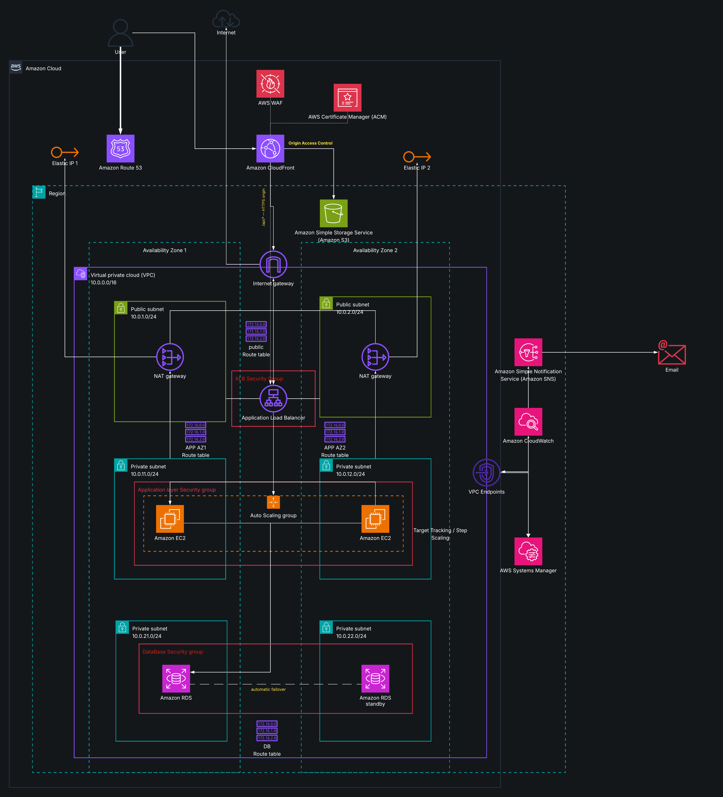

# Secure & Highly Available AWS Three-Tier Architecture

## Project Overview

This project implements a three-tier web application architecture on AWS, designed for high availability, scalability, and security.

The infrastructure is deployed within a VPC spanning two Availability Zones, with separate public, application, and database subnets. An Application Load Balancer distributes requests across EC2 instances managed by an Auto Scaling Group, while Amazon RDS Multi-AZ provides the database backend.

Amazon CloudFront and S3 handle static content delivery. Security controls include AWS WAF, Security Groups, Network ACLs, network isolation, and AWS Systems Manager for private instance administration. CloudWatch and SNS provide monitoring and alerting.

The project covers infrastructure design, deployment, security configuration, and validation.

## Architecture Diagram

## Architecture Overview

| Layer | AWS Services | Purpose |
|---|---|---|
| DNS & Content Delivery | Route 53, CloudFront, S3 | DNS resolution, CDN, static content |
| Web & Load Balancing | AWS WAF, ALB, ACM | Request filtering, HTTPS, traffic distribution |
| Application | EC2, Auto Scaling | Application hosting and automatic scaling |
| Database | Amazon RDS Multi-AZ | Persistent storage and automatic failover |
| Networking | VPC, Subnets, IGW, NAT Gateways | Network isolation and connectivity |
| Security & Administration | Security Groups, NACLs, Systems Manager, VPC Endpoints | Access control and private administration |
| Monitoring | CloudWatch, SNS | Metrics, alarms, and notifications |

## Network Configuration

The architecture uses a VPC with CIDR `10.0.0.0/16` spanning two Availability Zones.

### Subnet Allocation

| Subnet | CIDR | Availability Zone |
|---|---|---|
| Public Subnet 1 | `10.0.1.0/24` | AZ1 |
| Public Subnet 2 | `10.0.2.0/24` | AZ2 |
| Application Subnet 1 | `10.0.11.0/24` | AZ1 |
| Application Subnet 2 | `10.0.12.0/24` | AZ2 |
| Database Subnet 1 | `10.0.21.0/24` | AZ1 |
| Database Subnet 2 | `10.0.22.0/24` | AZ2 |

### Route Table Configuration

| Route Table | Destination | Target | Associated Subnets |
|---|---|---|---|
| Public RT | `0.0.0.0/0` | Internet Gateway | Public AZ1, AZ2 |
| App AZ1 RT | `0.0.0.0/0` | NAT Gateway AZ1 | Application AZ1 |
| App AZ2 RT | `0.0.0.0/0` | NAT Gateway AZ2 | Application AZ2 |
| Database RT | No default route | Local routing only | Database AZ1, AZ2 |

Every route table includes the local VPC route (`10.0.0.0/16 → local`).

The application subnets use separate NAT Gateways for outbound internet access. Database subnets have no direct internet route.

### Network ACL Configuration

Three custom Network ACLs are planned to provide subnet-level traffic filtering.

| Network ACL | Associated Subnets | Purpose |
|---|---|---|
| Public NACL | Public AZ1, AZ2 | Control ALB and NAT Gateway subnet traffic |
| Application NACL | Application AZ1, AZ2 | Restrict application subnet traffic |
| Database NACL | Database AZ1, AZ2 | Restrict database subnet traffic |

Unlike Security Groups, NACLs are stateless. Inbound and outbound rules must explicitly allow both requests and return traffic, including the required ephemeral ports.

Detailed allow/deny rules will be finalized and tested during deployment to avoid blocking legitimate application traffic, health checks, or database connections.

## Auto Scaling Group Configuration

The application tier runs on EC2 instances in private subnets across both Availability Zones.

| Parameter | Initial Configuration |
|---|---|
| Minimum Capacity | 2 |
| Desired Capacity | 2 |
| Maximum Capacity | 4 |
| Placement | Private Application Subnets |
| Instance Configuration | EC2 Launch Template |
| Load Balancing | ALB Target Group |
| Health Checks | EC2 and ELB |
| Scaling Policy | Target Tracking |
| Scaling Metric | Average CPU Utilization |
| Target CPU Utilization | 60% |

The ASG maintains application capacity, replaces unhealthy instances, and adjusts the number of instances based on demand.

## Security Group Configuration

Three Security Groups control communication between the ALB, application instances, and database.

### Inbound Rules

| Security Group | Protocol | Port | Source | Purpose |
|---|---|---|---|---|
| ALB SG | HTTPS | 443 | CloudFront origin-facing managed prefix list | CloudFront-to-ALB requests |
| Application SG | TCP | 8080 | ALB SG | Application requests and health checks |
| Database SG | PostgreSQL | 5432 | Application SG | Database connections |

### Outbound Rules

| Security Group | Protocol | Port | Destination | Purpose |
|---|---|---|---|---|
| ALB SG | TCP | 8080 | Application SG | Forward requests to EC2 |
| Application SG | TCP | 5432 | Database SG | Database access |
| Application SG | HTTPS | 443 | Required AWS service endpoints / approved external destinations | SSM, monitoring, package access |
| Database SG | — | — | No application-initiated outbound access required | Restrict database egress |

### Security Policy

- **ALB SG:** Accepts HTTPS traffic from CloudFront origin-facing addresses and forwards requests to the application tier.
- **Application SG:** Accepts application traffic only from the ALB and connects to the database on PostgreSQL port 5432.
- **Database SG:** Accepts database connections only from the application tier.
- **Administration:** EC2 instances are managed through AWS Systems Manager Session Manager without opening inbound SSH port 22.
- **Default deny:** Traffic not explicitly permitted by a Security Group rule is denied.
- **Stateful filtering:** Response traffic for allowed connections is automatically permitted.

CloudFront origin protection will also require an origin-specific control to prevent requests from unrelated CloudFront distributions. Additional endpoint Security Groups and outbound destinations will be defined during deployment.

## Application Traffic Flow

**Dynamic requests**

`User → Route 53 → CloudFront → AWS WAF → ALB → EC2 → RDS`

CloudFront forwards `/api/*` requests to the ALB. The ALB routes traffic to healthy EC2 targets, which communicate with the RDS database.

**Static content**

`User → Route 53 → CloudFront → S3`

CloudFront serves cached static assets and retrieves content from the private S3 bucket using Origin Access Control when required.

**Outbound application traffic**

`EC2 → NAT Gateway → Internet Gateway → Internet`

Each application subnet uses the NAT Gateway in its own Availability Zone.

**Monitoring and alerting**

`AWS Resources → CloudWatch → SNS → Email`

CloudWatch collects metrics and evaluates alarms. SNS delivers notifications when configured alarm conditions are met.

## Security and Defense in Depth

Security controls are applied at multiple layers.

| Layer | Security Controls |
|---|---|
| Edge | AWS WAF, CloudFront, HTTPS |
| Network | Private subnets, Security Groups, NACLs |
| Application | Restricted ALB-to-EC2 communication, IAM roles |
| Database | Private RDS, restricted database access, encryption |
| Administration | Systems Manager Session Manager, IAM |
| Monitoring | CloudWatch alarms and SNS notifications |

The security design follows the CIA Triad, Defense in Depth, and Principle of Least Privilege.

Detailed security rules, encryption settings, IAM permissions, and verification procedures will be added as the project progresses.

## Technology Stack

| Category | Technologies |
|---|---|
| Cloud Provider | AWS |
| Compute | Amazon EC2, EC2 Auto Scaling |
| Networking | Amazon VPC, ALB, NAT Gateway, Route 53 |
| Storage & Database | Amazon S3, Amazon RDS |
| Security | AWS WAF, IAM, Security Groups, NACLs, ACM, Systems Manager |
| Monitoring | Amazon CloudWatch, Amazon SNS |
| Infrastructure as Code | Terraform (planned) |
| Configuration Management | Ansible (planned) |

## Acknowledgments

This project was developed by **[Ilyas Mahrouq](https://www.linkedin.com/in/ilyas-mahrouq-ba45b3244/)** as part of the **AWS 2: Becoming a Solutions Architect** course on [Manara](https://manara.tech/), under the guidance of **[Ayman Mahmoud](https://www.linkedin.com/in/ayman-mahmoud/)**.

The project applies the AWS architecture, networking, scalability, and security concepts covered during the course.